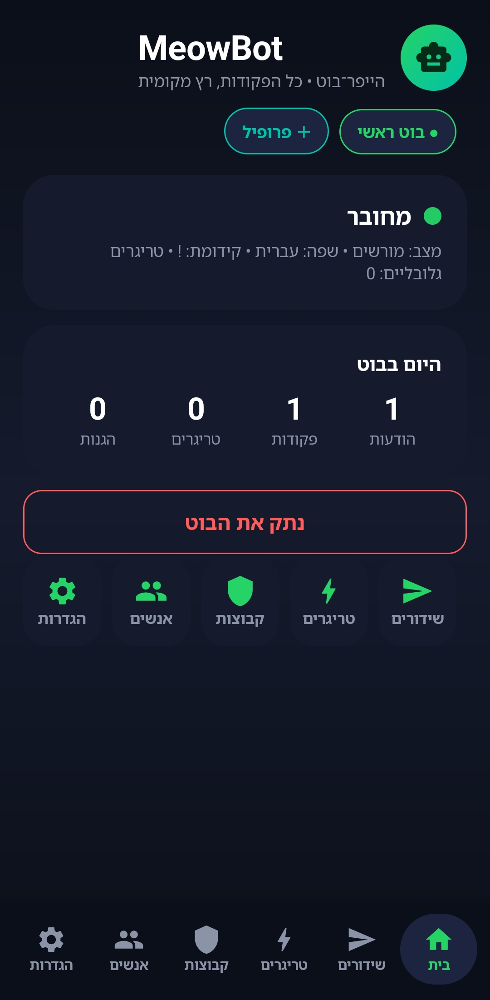
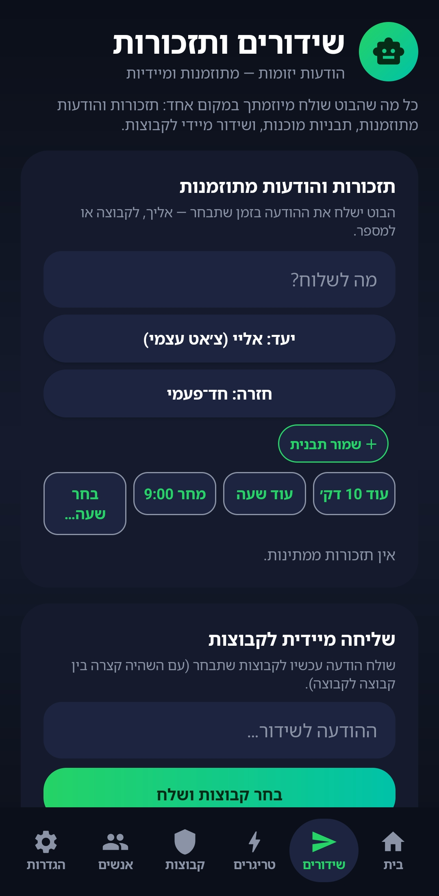
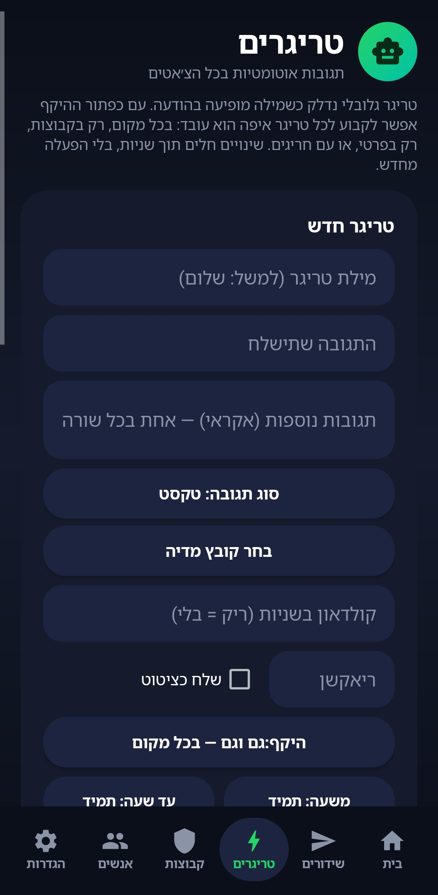
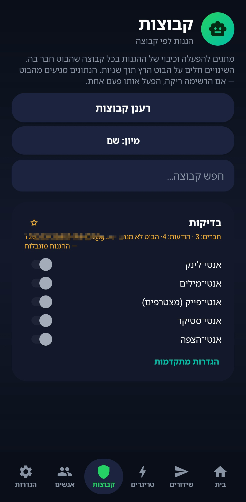
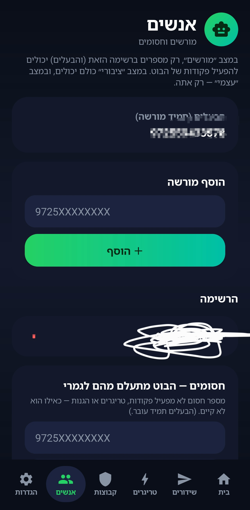
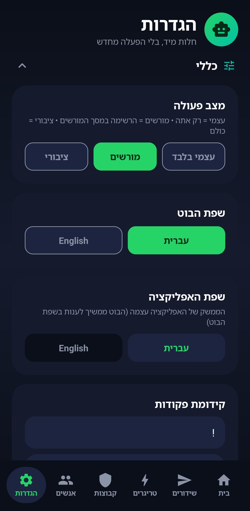

# MeowBot

**בוט וואטסאפ מלא שרץ בתוך אפליקציית אנדרואיד.**
בלי שרת, בלי Termux, בלי מחשב — מתקינים, מצמדים עם קוד, וזהו.

💚 **חינמי לחלוטין — בלי פרסומות ובלי שטויות.**

## ⬇️ הורדה

**[להורדת ה־APK האחרון](https://github.com/Hyperbot12/HyperBot/releases/latest/download/meowbot.apk)**
(תמיד הגרסה הכי חדשה) · [כל הגרסאות](https://github.com/Hyperbot12/HyperBot/releases)

## 📸 צילומי מסך

| בית | שידורים | טריגרים |
|---|---|---|
|  |  |  |

| קבוצות | אנשים | הגדרות |
|---|---|---|
|  |  |  |

## ⚡ מה יש בפנים

- **99 פקודות** — הורדות, מדבקות, AI, תרגום, חיפוש, כלי קבוצות ועוד
- **מדיה מובנית** — הורדות מיוטיוב / טיקטוק / אינסטגרם / X ויצירת מדבקות (yt-dlp + ffmpeg בתוך האפליקציה, לא צריך להתקין כלום)
- **פקודות AI** — שאל, סכם ודמיין (עם מפתח Gemini משלך)
- **הגנות לקבוצות** — אנטי־לינק, אנטי־מחיקה (הודעות מחוקות מתפרסמות מחדש), אנטי־פייק, אנטי־הצפה, אנטי־מילים, אנטי־סטיקר, שמירת צפייה־חד־פעמית
- **טריגרים חכמים** — מילה ← תגובה (טקסט, תמונה, סטיקר, וידאו או שמע), עם היקפים, תזמונים, קולדאון ומילות מעקב שמתריעות לטלפון
- **שידורים ותזכורות** — הודעות מתוזמנות, תבניות ושידור מיידי לקבוצות
- **ברכות כניסה ופרידה**, שעות שקט ו**מצב שבת אוטומטי**
- **שליטה מלאה מהאפליקציה** — טריגרים, קבוצות, מורשים והגנות, בלי לגעת בקוד
- **כמה פרופילי בוט** — יותר מבוט אחד, אפליקציה אחת
- **עדכונים בתוך האפליקציה** — גרסאות חדשות מוצעות בפנים, לא צריך להוריד כל פעם מחדש
- האפליקציה והבוט ב**עברית או באנגלית**

## 🚀 איך מתחילים

1. מורידים את ה־APK מהקישור למעלה
2. מתקינים (אנדרואיד יבקש לאשר התקנה מהדפדפן — אשרו)
3. פותחים את האפליקציה — אשף ההגדרה עושה את השאר:
   - מכניסים את מספר הוואטסאפ שהבוט ירוץ עליו
   - לוחצים התחבר ומקבלים **קוד צימוד**
   - בוואטסאפ של אותו מספר: **הגדרות ← מכשירים מקושרים ← קישור מכשיר ← קישור עם מספר טלפון**, ומכניסים את הקוד
4. בוחרים מצב (עצמי / מורשים / ציבורי) — ועלית לאוויר 🎉

## 📱 דרישות

- אנדרואיד 8 ומעלה
- מספר וואטסאפ לבוט (אפשר גם המספר שלך)

## 📝 כדאי לדעת

- בתפריט העזרה של הבוט (`!עזרה`) תמיד מופיע קישור ההורדה הרשמי — אל תקבלו חיקויים.
- זה פרויקט לא רשמי, בלי קשר לוואטסאפ או מטא. אוטומציה עלולה לגרום להגבלת המספר על ידי וואטסאפ — השתמשו במספר שאתם יכולים לוותר עליו, ואל תעשו ספאם.

---

נבנה ב־💚 — חינמי לתמיד.

